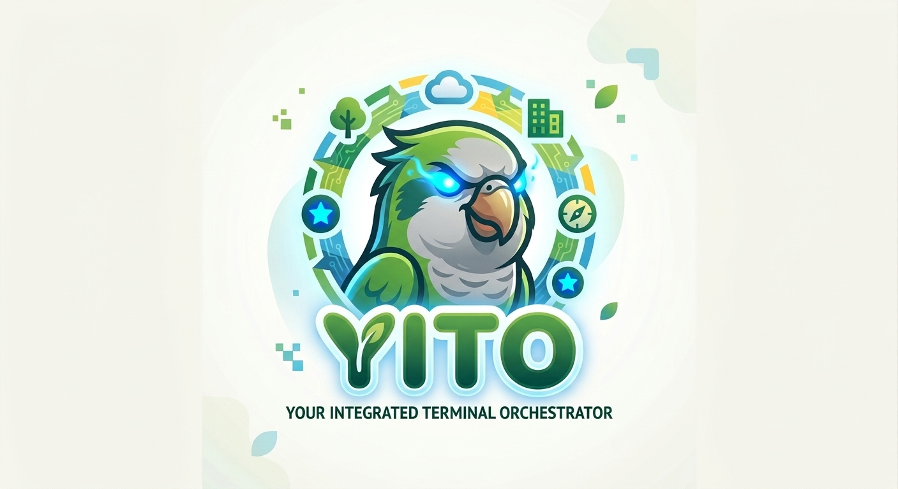
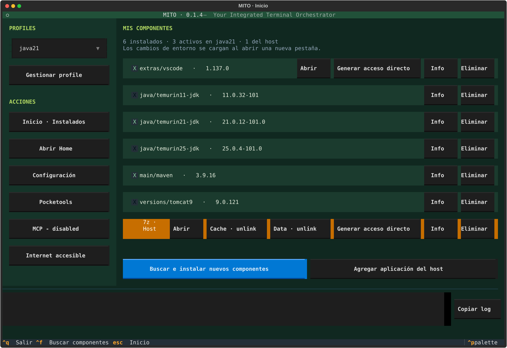
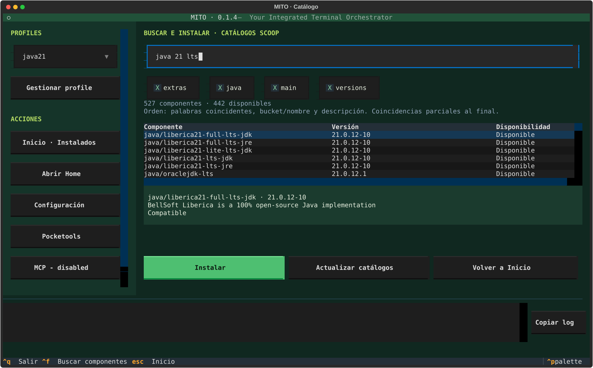

# MITO

**My Integrated Terminal Orchestrator**

Tu entorno de desarrollo de Windows, completo y portátil, dentro de una carpeta.
Combina herramientas, runtimes y aplicaciones en distintos profiles sin ensuciar
el sistema ni gestionar instalaciones duplicadas a mano.

## Un orquestador, todos tus entornos

- **Profiles a medida.** Java 11 para un proyecto, Java 25 para otro, o cualquier
  combinación de componentes: cada pestaña carga exactamente el entorno elegido.
- **Miles de herramientas.** Busca en catálogos Scoop con filtros y ranking rápido;
  MITO descarga, verifica, instala y actualiza con su propio motor Python.
- **Todo realmente portátil.** CPython, 7-Zip y Windows Terminal son privados. Home,
  `APPDATA`, variables, persistencia y workspaces permanecen dentro de MITO.
- **Tus aplicaciones, dentro del entorno.** Abre componentes o programas del host
  con el profile activo, en ventana independiente o acoplados a una pestaña.
- **Automatizable con IA.** Activa el servidor MCP local cuando lo necesites para
  que un agente gestione profiles, componentes y trabajos.
- **Preparado para equipos.** Profiles exportables, Pocketools compartidas, proxy
  corporativo, actualizaciones online u offline y 24 idiomas de la Unión Europea.

## Empieza en tres pasos

1. Descarga y extrae la [última release](https://github.com/danielgube/mito/releases/latest).
2. Ejecuta **`mito.cmd`**. Revisa la bienvenida y confirma la descarga de sus herramientas privadas.
3. Instala tus componentes, crea un profile y abre una pestaña PowerShell o CMD.

No necesitas instalar Python, Scoop ni Windows Terminal. Si quieres otra instancia
con otro home, basta con extraer MITO en otra carpeta.

Si el arranque falla, conserva `logs\mito.log` y sus copias `.1`, `.2`
y `.3`: el diagnóstico comienza en PowerShell, antes de instalar Python. Las nuevas
distribuciones envían informes de error a PostHog; puedes desactivarlo con
`posthog.enabled=false` sin perder el log local. Consulta los límites y datos
recogidos en el [manual](MANUAL.md#logs-locales-y-envío-de-errores-a-posthog).

## Hecho para durar

Cada componente tiene una ruta estable y una única versión instalada. Actualizar
sustituye los binarios sin romper configuraciones ni accesos y conserva los datos
persistentes. MITO comprueba novedades una vez al día y también acepta releases
offline, siempre verificando hashes cuando están disponibles.

MITO no promete compatibilidad mágica con todo Scoop: muestra qué manifiestos puede
ejecutar, pide confirmación antes de descargas sin hash y bloquea los pasos que aún
no soporta. El resultado es un entorno transparente, predecible y bajo tu control.

**[Abrir el manual completo](MANUAL.md)** · [Arquitectura](spec/ARCHITECTURE.md) · [Estado verificable](spec/CONTINUITY.md)
