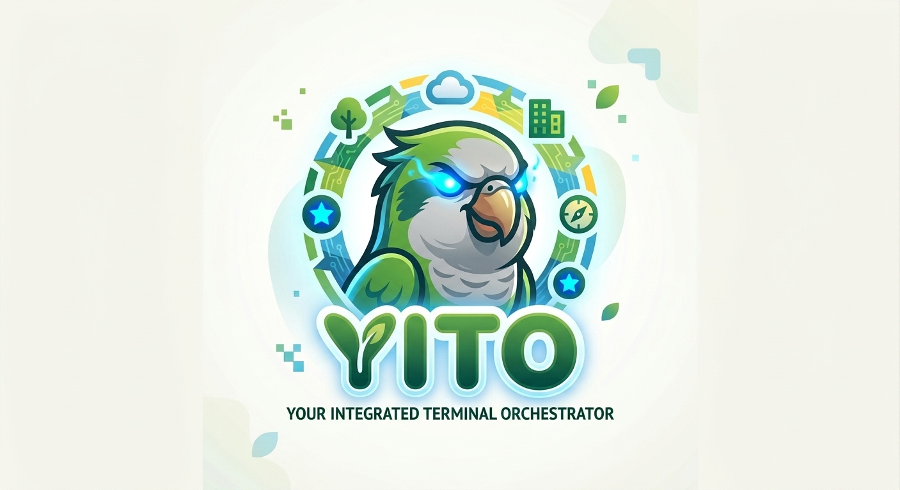

# MITO

**My Integrated Terminal Orchestrator**



Entornos de desarrollo portátiles para Windows x64. Catálogos Scoop, motor Python
propio y una interfaz Textual dentro de Windows Terminal portable.

## Abrir

Ejecuta `mito.cmd`. El bootstrap prepara CPython, Pillow, Textual, 7-Zip y Windows
Terminal privados, con versiones y hashes fijados. No requiere Python ni Scoop
globales. `mito.cmd ui` abre la interfaz dentro de la terminal actual.

El Terminal propio abre **maximizado**, manteniendo visibles las pestañas.
El menú junto a «+» ofrece MITO, PowerShell y CMD por cada profile, por ejemplo
`PowerShell (java11)` y `CMD (java21)`. Los lanzamientos de esta instancia reutilizan
su ventana y añaden pestañas. Los colores distinguen MITO (verde), PowerShell
(azul) y CMD (ámbar), con opacidad del 94 % y efecto acrílico.

Cada nueva pestaña carga las selecciones actuales del profile. Tras añadir Git o
cambiar Java, abre otra pestaña para cargar el nuevo entorno; no hace falta cerrar
toda la ventana. Las pestañas existentes no se reconfiguran en caliente. Al crear
un profile se actualiza el menú mediante los ajustes nativos de Windows Terminal,
sin monitores ni procesos auxiliares. Si un menú abierto no se refresca, reabre MITO.

**Inicio muestra todo lo instalado.** Cada componente tiene una casilla que indica
si está activo en el profile seleccionado. Marcar o desmarcar no instala ni borra.
Puedes activar varios Java o versiones de una misma app a la vez, sin restricciones
de familia: tú decides la combinación.

**Buscar e instalar** abre otra pantalla con los buckets de Scoop. Instalar añade
un componente a Inicio; después eliges en qué profiles activarlo.

El catálogo permite marcar los buckets que quieres buscar; la selección se conserva.
Busca por palabras y números, priorizando coincidencias en bucket/nombre sobre la
descripción. `python`, `python/` y `/python` son equivalentes. `java 21 lts` ordena
primero las coincidencias más completas; los resultados parciales aparecen después.
Las notas del manifiesto, incluidas advertencias, se muestran debajo de la descripción
en un panel desplazable. Inicio utiliza filas compactas de tres líneas.


La biblioteca de esta carpeta contiene Java 11, Java 21, Java 25 y VS Code. Los
profiles `java11` y `java21` mantienen sus selecciones; Java 25 comienza inactivo.

## Una carpeta, un home

- `home/`: único usuario portable, AppData, temporales, comandos propios y datos.
  Si necesitas otro home, crea otra instancia de MITO en otra ruta.
- `core/apps/`: una instalación por componente en `<bucket>/<app>`, con ruta estable.
- `core/profile-apps/`: copias independientes para componentes con `persist` y `shortcuts`.
- `profiles/`: selección de componentes activos y workspace, con rutas relativas.
- `workspaces/`: proyectos, que pueden compartirse entre profiles.
- `core/buckets/`: snapshots de manifiestos; no requieren mantener C:\scoop ni EAP.

El entorno sólo se aplica a procesos hijos. Activar componentes distintos puede producir
colisiones en PATH, variables y comandos; MITO no impide ni corrige esa elección.

El manifiesto decide el alcance de cada componente, sin excepciones por nombre:

- Con `persist` **y** `shortcuts`: copia de binarios y persistencia independientes por profile.
- Sin esa combinación: binarios y persistencia compartidos.

Las copias se preparan al construir por primera vez el entorno del profile, bajo
`core/profile-apps/<profile>/<bucket>/<app>/<versión>/`. Sus datos viven en
`home/profiles/<profile>/persist/<bucket>/<app>/`; sigue existiendo un único home.
PATH, env_set, los comandos y Abrir utilizan la copia correspondiente.
Desactivar no borra la copia ni sus datos. Al actualizar, la nueva copia reutiliza
la persistencia de ese profile; al eliminar una instalación se retiran todas sus
copias, conservando sus datos. Eliminar un profile conserva también sus copias y datos.

Las copias usan los datos iniciales del paquete. Los datos compartidos de instalaciones
anteriores se conservan, pero no se duplican ni migran automáticamente. Esta separación
no garantiza que todas las aplicaciones permitan instancias simultáneas.

## Configuración de profiles

El idioma de la interfaz se selecciona en **ACCIONES → Configuración →
mito.language**, o escribiendo `mito.language=english` en `config.properties`.
Los valores disponibles son `system` (predeterminado, **Automático (Windows)** en
el selector) y todos los idiomas oficiales de la Unión Europea. En automático,
MITO detecta el idioma de interfaz de Windows, incluidas sus variantes regionales;
un idioma no admitido o un fallo de detección usa inglés. La selección manual tiene prioridad.
Si falta la propiedad, también se detecta automáticamente. Guarda y vuelve
a abrir el gestor MITO para aplicar el cambio. Es una preferencia de la instancia,
compartida por todos los profiles. Los catálogos de Scoop conservan sus nombres,
descripciones y notas originales. La salida de la CLI y del bootstrap sigue en español.

En **ACCIONES → Configuración** puedes editar `config.properties`. El selector
permite añadir propiedades reconocidas o variables de entorno, que se muestran sin
el prefijo `env.`. Las claves reconocidas son fijas; los valores finitos se eligen
en un combo (por ejemplo, `true` / `false`) y los demás se escriben en un campo de texto.
También puedes añadir fuentes `bucket.<nombre>` y campos del formulario del proxy.

En **Gestionar profile → Configuración** editas exclusivamente las variables `env`
del profile seleccionado. Tienen prioridad sobre las globales. Cada fila permite
eliminar una propiedad; **Guardar** aplica todos los cambios. La cruz y Escape
cierran sin guardar. Las variables reservadas y las claves duplicadas se rechazan.
Los cambios de entorno se aplican al abrir nuevas pestañas o aplicaciones; los
cambios de fuentes se utilizan al refrescar el catálogo.

Cada archivo `profiles/<nombre>.json` contiene sólo el workspace, los identificadores
ordenados de instalaciones activas y variables de entorno opcionales:

```json
{
  "workspace": "java11",
  "apps": ["java/temurin11-jdk@b8d72c1344fc9d67"],
  "env": {
    "MAVEN_OPTS": "-Xmx2g",
    "MY_SETTING": "desarrollo"
  }
}
```

Los IDs reales se muestran con `mito.cmd installed`. `env` admite valores de texto
literales, sin expansión de variables; se aplica después de las variables declaradas
por los componentes. Los nombres no distinguen mayúsculas. PATH, MITO_* y las
variables del home portable (HOME, USERPROFILE, APPDATA, LOCALAPPDATA, TEMP, TMP,
HOMEDRIVE y HOMEPATH) están reservadas. Abre otra pestaña o lanza de nuevo la app
para aplicar cambios. No se modifica el entorno global de Windows.

Para variables comunes a todos los profiles, utiliza el prefijo `env.` en
`config.properties`:

```properties
env.MAVEN_OPTS=-Xmx2g
env.MI_VARIABLE=desarrollo
```

Prioridad de menor a mayor: variables del componente → `env.` global → `env` del
profile. Se aplican las mismas variables reservadas y valores literales. En properties
se separa por el primer `=`, se recortan espacios exteriores y no se interpretan
comillas ni escapes; `env.VARIABLE=` establece una cadena vacía. Los cambios se leen
al construir cada nuevo entorno, sin reiniciar MITO.

## Información del componente

**Info** aparece en todas las instalaciones y abre un diálogo con descripción,
notas, binarios base y rutas persistentes. Cada ruta tiene un botón **Abrir** a la
derecha para mostrarla en el Explorador; para archivos se abre la carpeta contenedora.
Las rutas aún no creadas se muestran como pendientes, con el botón deshabilitado.
En componentes aislados también se muestran los binarios del profile seleccionado.
Se utiliza la persistencia del profile seleccionado cuando persist + shortcuts
requiere aislamiento; en los demás casos se muestra la compartida. Consultar rutas
no activa componentes, no crea datos y no prepara copias.

## Eliminar y actualizar componentes

Cada instalación muestra **Eliminar**, con confirmación de versión y profiles afectados.
Se retira de esos profiles y se borran sus archivos; el home, los datos persistentes y
los workspaces se conservan. Cierra la aplicación antes de eliminarla. Sus dependientes
o accesos directos pueden dejar de funcionar; no se borran otras instalaciones.

**Actualizar** aparece cuando el catálogo local contiene una versión numéricamente
posterior. Al abrir el gestor se consultan sólo los manifiestos de componentes instalados,
estén activos o no, sin sincronizar los catálogos completos.
Si el manifiesto nuevo no está soportado, el botón queda deshabilitado con el motivo.
Primero se prepara la versión nueva y sus dependencias; después se sustituyen los
binarios en su ruta estable, incluidas las copias por profile. Las selecciones siguen
identificando el mismo componente y reciben sus dependencias nuevas. Se conservan
los datos persistentes y la activación. Un componente inactivo se actualiza sin
activarlo. Cierra la aplicación antes de actualizar y abre nuevas
pestañas para cargar el cambio. Los accesos antiguos registrados se convierten al
nombre del componente; los nuevos accesos ya no dependen de la versión.
Las versiones sin numeración comparable no se actualizan automáticamente.

## Accesos de aplicaciones

Las consolas se abren desde las pestañas de Windows Terminal.
El botón **Acceso directo**, dentro de Gestionar profile, genera un acceso a **MITO**
en el escritorio: abre el gestor con el profile seleccionado y permite elegir
hasta cuatro caracteres para su icono. No se generan enlaces en la raíz.

**Eliminar profile** elimina su configuración y selecciona otro. No permite borrar
el último; conserva los componentes, home y workspace. Se guarda una copia de la
configuración eliminada en `core/state/deleted-profiles`. Las pestañas ya abiertas
conservan su entorno; los accesos existentes de ese profile dejan de ser válidos.

En **MIS COMPONENTES**, «Abrir» y «Generar acceso directo» sólo aparecen si el
componente está activo y declara un ejecutable que existe. Se utilizan las
entradas shortcuts/bin del manifiesto, sin reglas específicas para Java u otros
productos. No se buscan ejecutables recorriendo carpetas de runtimes.

«Abrir» muestra un diálogo con apertura independiente o acoplada. La apertura
acoplada crea una pestaña dedicada, titulada con el nombre de la aplicación, y
mantiene en ella el árbol de procesos. Cerrar esa pestaña o su ventana termina la
aplicación y sus descendientes mediante un Job Object. Es una terminación forzada:
la aplicación puede no tener ocasión de guardar cambios. Procesos delegados a una
instancia previa, un servicio u otro broker externo quedan fuera de ese árbol.

El mismo diálogo ofrece **Argumentos** para cualquier ejecutable lanzable, tanto si
procede de `shortcuts` como de `bin`. Se escriben con la sintaxis de argumentos de
Windows; las comillas agrupan valores con espacios y no se entregan a la aplicación.
Estos argumentos se añaden después de los argumentos fijos del manifiesto. En modo
acoplado, al terminar se conserva la salida, se muestra el código y se espera Intro
para cerrar la pestaña, también con código cero o si no llega a arrancar. El código
del lanzador no garantiza que todos sus procesos hijos hayan terminado correctamente.

«Generar acceso directo» crea un `.lnk` en el escritorio real de Windows (incluido
si está redirigido a OneDrive), con el profile actual y bucket/app, sin versión ni
huella de instalación. Por ejemplo: `java21 - extras-vscode.lnk`, cuyo comando usa
`run --profile java21 --app extras/vscode`. El registro también es independiente de
la versión, por lo que regenerar un acceso nuevo después de actualizar reutiliza
su nombre y registro.
No se crean accesos de aplicaciones al instalar, activar o regenerar profiles.
El acceso necesita que haya una única instalación activa de ese componente en el profile.

Los iconos se componen con Pillow, como en EAP: se conserva cada resolución del
ICO del ejecutable y se superpone una etiqueta en la esquina inferior derecha.
Si no se puede extraer el icono, se usa el ICO de MITO. La etiqueta admite hasta
**4 letras o números**. Al pulsar «Generar acceso directo» se abre un diálogo con
**MITO** por defecto, editable antes de generar; Cancelar o Escape no crean nada.
La CLI permite `--badge` o el valor de `shortcut.badgeText` en config.properties.
El mismo diálogo permite elegir si el acceso abre la aplicación de forma
independiente o acoplada y definir **Argumentos**. El modo y la lista de argumentos
quedan guardados en el registro del acceso y se aplican en cada ejecución.

La base es `core/assets/branding/mito.ico`, con transparencia y tamaños de 16 a
256 píxeles, derivada de `mito_icon.png`. Conservamos el JPG original y el antiguo
ICO (`mito-original.ico`). El logo vive en `core/assets/branding/mito_logo.png`.

Tras mover MITO, vuelve a generar los accesos de apps desde MIS COMPONENTES:
Windows guarda rutas absolutas en los `.lnk`; payloads y locks usan rutas relativas.

## CLI

```bat
mito.cmd bucket refresh
mito.cmd search temurin
mito.cmd search --compatible
mito.cmd install java/temurin25-jdk
mito.cmd installed
mito.cmd profile create desarrollo --workspace mi-proyecto
mito.cmd profile delete desarrollo
mito.cmd start --profile java11
mito.cmd shortcut --profile java11 --badge J11
mito.cmd activate bucket/app --profile desarrollo
mito.cmd deactivate bucket/app --profile desarrollo
mito.cmd terminal --profile desarrollo
mito.cmd run --profile java11 --app extras/vscode
mito.cmd app-shortcut bucket/app --profile desarrollo --badge MITO
mito.cmd doctor
```

Usa el identificador real mostrado por `installed` en activate/deactivate.
`install <app> --profile <nombre>` conserva el atajo de instalar y activar juntos.
Si ya había otra versión activa, la nueva se añade sin desactivar la anterior.

Configura fuentes en `config.properties`. También puedes importarlas sin Git:

```bat
mito.cmd bucket import main C:\scoop\Main-master
mito.cmd bucket import extras C:\scoop\Extras-master
```

Actualizar catálogos no cambia versiones instaladas ni activaciones existentes.

## Proxy y conexión a Internet

Configura el proxy sin usuario ni contraseña en `config.properties`:

```properties
http_proxy=http://proxy.organizacion.example:8080
https_proxy=http://proxy.organizacion.example:8080
no_proxy=localhost,127.0.0.1,.organizacion.example
enable_proxy_authentication=true
proxy_authentication_url=https://portal.organizacion.example/login
proxy_authentication_username_field=username
proxy_authentication_password_field=password
```

Inicio comprueba Internet en segundo plano y muestra un botón de estado. Al pulsarlo,
comprueba otra vez. Si hay red pero no Internet, diagnostica la red. Prueba la ruta
configurada, el proxy de Windows (manual, PAC o WPAD) y, si había proxy configurado,
la conexión directa. Si una ruta funciona o redirige a un portal, propone las claves
(`http_proxy`, `https_proxy`, `no_proxy` y el portal con sus campos) y sólo las guarda
con **Guardar y conectar**. Después, con un portal, solicita usuario y contraseña para
esa sesión; nunca se guardan. HTTP 407 y otras respuestas sólo se notifican. Escape cancela. Una comprobación fallida no demuestra por sí
sola que todo Internet esté bloqueado: puede estar bloqueado el destino de prueba.
`network.check_url`, `network.check_status` y `network.timeout_seconds` permiten
ajustarlo; por defecto se espera HTTP 204 de Google en una petición sin redirecciones.
Con el gestor abierto, el botón INTERNET se vuelve a comprobar en segundo plano cada
`network.poll_seconds` segundos (20 por defecto, mínimo 5, 0 lo desactiva; se aplica al
reabrir MITO). Sólo se redibuja ese botón, y en rojo cuando no hay Internet. La
comprobación periódica no abre diálogos ni escribe avisos en el log.

Los accesos directos de aplicaciones comprueban la conexión antes del lanzamiento.
Si hace falta autenticarse muestran una ventana de Windows con contraseña oculta;
cancelar continúa abriendo la aplicación. No se guardan credenciales ni se incluyen
en argumentos, variables de entorno o logs. No hace falta regenerar los accesos.
Los comandos de herramientas (`run --bin`) no muestran este interceptor.

El portal recibe un POST de formulario: se conservan campos ocultos y cookies sólo
en memoria durante la autenticación. Puedes añadir campos con
`proxy_authentication_form_field.NOMBRE=valor`. Se valida TLS y se exige HTTPS para
el POST salvo `proxy_authentication_require_https=false` explícito. El formulario
debe enviar al mismo origen configurado. No se reenvían credenciales en redirecciones.
Se comprueba Internet con una sesión nueva antes de declarar éxito.

Este flujo sirve para portales que autorizan la conexión del equipo. No implementa
HTTP 407 Basic/NTLM, SSO interactivo ni CAPTCHA, y no exporta cookies a aplicaciones.
Los procesos reciben HTTP_PROXY/HTTPS_PROXY/NO_PROXY, pero cada aplicación decide
si respeta esas variables. Las descargas de MITO sí usan el proxy configurado y
mantienen la verificación de hashes. No se modifica el proxy global de Windows.

El bootstrap inicial usa `https_proxy` si está declarado; un valor vacío fuerza
conexión directa. Si `config.properties` no declara `http_proxy` ni `https_proxy`,
detecta el proxy con Windows (`HTTPS_PROXY` del entorno, configuración manual,
script PAC o WPAD), ya que Python no evalúa PAC, y comprueba `network.check_url`:

- HTTP 204: el proxy da acceso directo a Internet.
- HTTP 407: indica los esquemas (Basic, NTLM, Negotiate). Si la sesión de Windows
  basta, PowerShell la usa, pero las descargas de Python pueden fallar.
- Redirección: portal de autenticación; propone su URL y los campos del formulario.

Muestra las claves y pregunta si guardarlas (`[S/n]`). Si no se guardan, el proxy
sólo se usa durante esa preparación. Con un portal configurado o detectado y sin
Internet, pide usuario y contraseña en la consola (contraseña oculta, hasta tres
intentos, vacío para omitir) con las mismas reglas de origen, HTTPS y comprobación
final que el diálogo de MITO. Se guarda un único proxy: si el PAC devuelve proxies
distintos por destino, sólo vale el resuelto para la descarga de Python. El
actualizador (`-Approved`) nunca pregunta: usa el proxy detectado sin guardarlo.
Desde Python, también las descargas del bootstrap usan el proxy.

Para ver el proxy de Windows en una consola, incluido el resuelto por PAC:

```powershell
[Net.WebRequest]::GetSystemWebProxy().GetProxy([Uri]'https://github.com/')
```

## Crear releases

```bat
mito.cmd release
```

Desde el checkout de `danielgube/mito`, con `main` limpio y sincronizado,
usa la sesión de Git Credential Manager para publicar automáticamente en GitHub.
Incrementa el parche sobre la mayor versión local/remota (`0.1.0 → 0.1.1`), ejecuta
las pruebas, crea el commit de versión y lo sube. Crea la release inicialmente como
borrador, sube el ZIP mínimo y su SHA-256, verifica los hashes y la publica.

Si falla la conexión, repite el comando: reanuda la versión pendiente sin volver a
incrementar ni sobrescribir archivos remotos distintos. Los cambios del programa
se deben guardar con commit y push antes de ejecutar release.

`mito.cmd release --local` conserva la opción de generar únicamente el ZIP de la
versión actual, sin incrementar ni publicar. `--output RUTA` cambia la carpeta de
salida; por defecto es `releases/`. Los ZIP no se guardan en Git, sino como assets
de la release de GitHub.

La distribución mínima contiene el código Python, el ICO y el bootstrap con hashes fijados,
configuración pública de buckets y un profile `default` vacío. Excluye home,
workspaces, componentes, cachés, runtimes y configuración local, documentación, PNG/JPG originales y previsualizaciones. Es una release
limpia, no una copia de seguridad de la instancia. Al extraerla y ejecutar
mito.cmd se descargan las herramientas privadas; se necesita Internet. Actualiza
los catálogos desde la interfaz o con `mito.cmd bucket refresh`.

## Motor Scoop propio

Actualmente acepta descargas y redirecciones HTTP/HTTPS (incluido HTTPS a HTTP),
arquitectura x64, varias URL, hashes opcionales (MD5, SHA-1, SHA-256/SHA-512),
extract_dir/extract_to, ZIP (incluido Deflate64 mediante 7-Zip), 7z, RAR, TAR comprimido, archivos sueltos, persist,
env_add_path/env_set, bin con aliases/argumentos, shortcuts y dependencias.

Persist guarda datos en `home/persist/<bucket>/<app>/`. Los defaults se conservan
y los enlaces se reconstruyen al activar, también después de trasladar MITO.
La instalación valida descargas y rutas, extrae en staging y publica los payloads
antes de guardar el profile. Los datos del home no se eliminan al desactivar.

**La compatibilidad no es todavía total.** `pre_install` se ejecuta con PowerShell
después de extraer; `post_install` se omite. Los detalles y el registro lo indican.
Usa catálogos de confianza: estos scripts tienen los permisos de tu usuario.
No todas las funciones internas de Scoop están implementadas; si falta una, la
instalación falla sin publicar el payload. No hay excepciones por producto: un manifiesto
con instaladores MSI/Inno o módulos PowerShell aún no implementados aparece como
«Todavía no soportado», independientemente de su nombre. Las instalaciones ya
existentes se conservan y usan las mismas reglas genéricas de entorno y persistencia.

El core no modifica PATH global ni registra programas por sí mismo, pero un pre_install
puede hacerlo. Una app del catálogo no
queda confinada como en un sandbox: puede necesitar adaptación adicional para
evitar escrituras propias fuera del home.

Restauración desde lock y limpieza de versiones se desarrollarán después.

## Aplicaciones del host con entorno MITO

En Inicio, **Agregar aplicación del host** abre el selector de archivos para elegir
un `.exe`, `.bat`, `.cmd` o `.ps1`. Se registra su ubicación original, sin copiarlo ni
instalarlo. Aparece en Mis componentes como aplicación del host.

**Abrir** utiliza el profile seleccionado: su PATH, variables, APPDATA de MITO y
workspace, y ofrece también los modos independiente y acoplado y argumentos.
**Generar acceso directo** pide la etiqueta habitual de hasta cuatro caracteres,
el modo de apertura y los argumentos, y conserva ese profile. **Info** muestra la
ubicación del ejecutable y abre su carpeta. **Eliminar** quita la referencia tras confirmar, conservando el
ejecutable del host y sus datos. Las referencias se comparten entre profiles, pero
cada lanzamiento usa el entorno seleccionado; no se incluyen al exportar un profile.

## Pocketools compartidas

Paquetes de scripts compartidos por todos los profiles. Configura sus fuentes desde
**Configuración → pocketool.<nombre>**, o en `config.properties`:

```properties
pocketool.ciges=https://servidor.example/ciges.git
pocketool.example=C:/pocketool-example
```

El único archivo obligatorio en la raíz del repositorio es `pocketool.json`:

```json
{"info": "Herramientas corporativas y alias de CIGES"}
```

En **ACCIONES → Pocketools**, pulsa **Actualizar** junto al paquete. Se sincroniza
en `pocketools/<nombre>` y se muestra su descripción. Abre una nueva pestaña para
que su raíz esté en PATH. Las subcarpetas se conservan; los scripts pueden acceder
a ellas mediante `$PSScriptRoot` en PowerShell y `%~dp0` en CMD.

Actualizar sustituye la copia local completa. Si el origen falla o falta un
`pocketool.json` válido, se conserva la anterior. Quitar la propiedad retira el paquete
del PATH de nuevos entornos, pero conserva sus archivos.

La sincronización remota necesita Git accesible en el host o en un componente
instalado de MITO. Usa la rama predeterminada y el proxy configurado; los repositorios
privados requieren credenciales disponibles en Git. No gestiona submódulos ni LFS.
Para pruebas se admite una carpeta local sin inicializar un repositorio Git.
MITO no ejecuta los scripts al sincronizar ni instala sus dependencias: si requieren
Python, Node u otra herramienta, debe estar disponible en el entorno que los ejecuta.

## Desarrollo

```bat
core\tools\python\python.exe -B -I -X utf8 -m unittest discover -s core\tests -v
mito.cmd doctor
```

Consulta `ARCHITECTURE.md` y `CONTINUITY.md` para contratos, pruebas y
continuidad del proyecto. Los runtimes, payloads, datos y snapshots no van a Git.

## Hashes opcionales en catálogos

Puedes omitir hash, usar null, una cadena vacía o "skip" para descargar sin
verificación. Con varias URL, puedes omitir todos los hashes o proporcionar una
lista del mismo tamaño, combinando hashes y null/skip. Los hashes declarados se
comprueban y una discrepancia descarta la descarga. Se aceptan prefijos como md5:,
sha1:, sha256: y sha512:; sin prefijo se reconocen por longitud (32/40/64/128 hex).
El bootstrap conserva sus hashes fijados. HTTP y HTTPS siguen admitidos.

Antes de instalar o actualizar, MITO pide confirmación si alguna descarga pendiente
no tiene hash, incluidas dependencias y entradas null/vacías/skip. El popup muestra
los componentes afectados; Cancelar o Escape no descargan nada. La CLI pregunta
[s/N]. Las instalaciones ya presentes no vuelven a solicitar confirmación.

## Registro de operaciones

Los errores se muestran en rojo y negrita. El botón Copiar log copia el registro
completo de la sesión al portapapeles de Windows, con saltos de línea y sin colores.
Está disponible también mientras hay una operación en curso.

## Compartir profiles

En Inicio → **Gestionar profile**, **Exportar** guarda un JSON con los nombres bucket/app activos del profile
seleccionado. El diálogo propone exports/<profile>.mito.json; puedes elegir otra ruta.
No sobrescribe archivos existentes. No incluye env, workspace, rutas, manifiestos,
binarios, sesiones, persistencia ni configuración de proxy.

**Importar** abre el selector de archivos de Windows para elegir el JSON y pide un
nombre nuevo. Examinar permite volver a abrirlo; también puedes escribir la ruta. Antes de continuar muestra los
componentes y dependencias, sus versiones y cuáles ya están instalados. Al confirmar,
instala lo que falta, sustituye componentes cuyo manifiesto cambió y crea el profile
con todas esas selecciones activas y env vacío. La revisión indica las sustituciones
que afectan a otros profiles.
Cancelar no crea el profile. Si una descarga falla, tampoco se crea; la publicación
del plan revierte sus binarios si falla antes de la limpieza final.

Se usan las versiones disponibles en los catálogos locales del destinatario. No es
un lock de versiones históricas: cada bucket/app identifica un único componente.
Java 11 y Java 21 con nombres de paquete distintos sí se
conservan como entradas independientes. Actualiza los catálogos o configura los
buckets necesarios antes de importar. No se importan fuentes ni URLs desde el archivo.
El nuevo entorno utiliza la configuración global del destinatario.

```bat
mito.cmd profile export java11 entorno.mito.json
mito.cmd profile import entorno.mito.json --name desarrollo
```

Las descargas sin hash mantienen su confirmación adicional. El archivo compartido
es tan sencillo como:

```json
{"apps": ["main/nodejs", "main/python", "java/temurin21-jdk"]}
```

## Gestión de profiles

La barra lateral muestra PROFILES (selector y Gestionar profile) y ACCIONES
(Inicio · Instalados e Internet). Gestionar profile reúne Crear profile, Exportar,
Importar, Acceso directo y Eliminar profile. Eliminar requiere confirmación, permite
cancelar con Escape y permanece deshabilitado si sólo queda un profile.
La cabecera muestra la versión real de MITO.
## Datos y caché de aplicaciones del host

En ACCIONES, **Abrir Home** abre `home` de MITO en el Explorador de archivos.

Al agregar un ejecutable, MITO busca carpetas que contengan su nombre primero en
AppData/Roaming y después en AppData/Local. Puedes aceptar o cancelar cada enlace.
Si ya existe la carpeta de destino en MITO, se pide confirmar su borrado por separado.

**Data** corresponde a Roaming y **Cache** a Local. Ambos botones muestran
link/unlink y permanecen disponibles. Sin enlace vuelven a buscar candidatos y
permiten seleccionar una carpeta manualmente desde el AppData correspondiente,
revisando las rutas antes de pulsar Enlazar. Con enlace permiten
retirar los enlaces de esa categoría, conservando los datos del host.

Los enlaces son junctions compartidas por todos los profiles y permiten escribir
directamente en los datos del host. Cierra la aplicación antes de cambiarlos.
MITO reconoce también junctions creadas manualmente cuando la ruta coincide con
el nombre de la aplicación y apunta a la misma carpeta relativa en el AppData
del host. Se muestran como link y pueden desenlazarse con confirmación. Enlazar
al mismo destino reutiliza la junction existente sin borrarla.
Eliminar la aplicación de MITO elimina también sus junctions, conservando el
ejecutable y los datos del host. Desenlazar no importa ni copia esos datos a MITO.


## Rutas estables y actualización

Cada componente bucket/app tiene una única versión instalada. Por ejemplo,
`core/apps/versions/tomcat9` es la ruta para configurar un servidor en Eclipse.
Actualizar sustituye sus binarios y mantiene esa ruta. `versions/tomcat10`,
`versions/tomcat11` y `main/tomcat` son componentes independientes.
Para persist + shortcuts las copias viven en
`core/profile-apps/<profile>/<bucket>/<app>`; se actualizan también las copias
inactivas, conservando los datos separados de cada profile. Cierra las aplicaciones
antes de actualizar. No se cambian entornos de procesos ya abiertos.

Instancias antiguas: ejecuta `mito.cmd migrate-storage` con las aplicaciones cerradas.
Convierte rutas y selecciones sin descargar ni cambiar versiones. Si encuentra
varias instalaciones antiguas del mismo componente o contenido ambiguo, se detiene
sin borrar nada. Las rutas guardadas en Eclipse u otras herramientas necesitan
corregirse una vez; las actualizaciones posteriores conservan la nueva ruta.


## Agentes mediante MCP

En el menú principal pulsa **MCP - disabled**. El diálogo muestra el estado, el
puerto y las instrucciones para Codex, Claude Code, VS Code y HTTP genérico.
Pulsa **enabled**: aparecerá una pestaña **MITO MCP** en la ventana de MITO.
Cuando figure enabled, elige el cliente y copia su configuración. No se modifican
archivos de clientes automáticamente. Usa la URL exacta del diálogo, sin credenciales.
La conexión es Streamable HTTP local; MCP no está expuesto a otros equipos.

Cada apertura del gestor empieza disabled. Se recuerdan identidad y puerto, nunca
la activación. Puerto 0 elige uno libre y guarda el elegido. Si está ocupado, se
muestra el error; puedes elegir otro puerto o 0 y volver a activar, actualizando
la configuración del cliente. Otro gestor de la misma instancia no puede activar
un segundo servidor mientras siga activo el primero.

**disabled** detiene el servidor. Cerrar la pestaña MCP, la ventana de Windows
Terminal o el gestor propietario también lo apaga. No se reactiva automáticamente.
Al desactivar normalmente se cancelan comandos y confirmaciones pendientes; una
instalación que ya está publicando termina antes del apagado. El cierre forzado no
puede garantizar deshacer operaciones iniciadas.

Las herramientas permiten:

- Consultar estado; listar, crear, configurar y eliminar profiles conservando datos.
- Buscar/refrescar catálogos y planificar, instalar, actualizar o retirar componentes.
- Activar/desactivar componentes por profile y configurar variables, fuentes y pocketools.
- Ejecutar comandos y consultar trabajos, resultados, stdout/stderr o cancelarlos.

El agente debe usar nombres completos bucket/app, instalar y activar por separado,
y consultar job_get hasta que termine una operación. Los cambios de configuración
requieren la revisión devuelta por la lectura anterior. request_id permite repetir
una solicitud sin duplicarla durante esa activación de MCP. Las descargas sin hash,
incluso de dependencias, esperan confirmación humana en MITO antes de descargar.

command_start acepta argv o script con shell cmd/powershell, profile y cwd relativo
al workspace. El timeout predeterminado es 300 segundos; admite hasta 86400 y 0 para
continuar hasta cancelación. No son sesiones interactivas: stdin se entrega al arrancar.
Los procesos usan los permisos del usuario y pueden acceder fuera del workspace.
La salida se decodifica como UTF-8 por defecto; indica encoding para herramientas con
otra codificación. BAT/CMD admite espacios, %, ! y &, pero argv con comillas o saltos
de línea se rechaza: en ese caso proporciona un script explícito.

El diálogo MCP sólo muestra conexión y configuración. El encabezado y el cierre
permanecen visibles al desplazar su contenido.

El monitor de trabajos es opcional: en **Configuración**, cambia
`mcp.jobs.monitor` de `false` (predeterminado) a `true` y guarda. Aparecerá el botón
**MCP · Jobs**, que abre su propio diálogo para seleccionar un trabajo, consultar
sus primeros 64 KiB por stream con **Actualizar** y cancelarlo. Los estados se
refrescan, pero la salida no se carga automáticamente. Cada entrada incluye un ID
abreviado para distinguir comandos repetidos. Volver a false oculta el botón;
no cancela trabajos ni desactiva las herramientas de consulta de la IA. El agente puede recorrer toda la salida retenida con job_output y
next_cursor. El máximo es 10 MiB por job y 64 MiB por activación; truncated indica
recorte. Hay cuatro workers, hasta 32 trabajos pendientes y 128 en total por
activación. Al alcanzar el total, revisa resultados y desactiva/reactiva MCP.
Los registros de sesiones anteriores quedan temporalmente en core/state/mcp/jobs
para diagnóstico; no se reejecutan ni se consultan por la API de la sesión nueva.

Si actualizas el código sobre un runtime ya preparado, ejecuta `mito.cmd bootstrap`
una vez para instalar las nuevas dependencias fijadas. `mito.cmd doctor` comprueba
que el SDK esté disponible sin arrancar el servidor.

Verificación de clientes y límites observados: [CONTINUITY](CONTINUITY.md).
